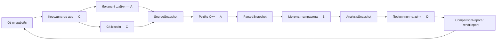

# Code Xray

**Code Xray** — настільний застосунок на C++, який допоможе розібратися у структурі C++ проєкту й побачити, що змінилося між двома версіями. Він збирає результати розбору, метрики та перевірок у звіт, з яким команді зручніше обговорювати зміни.

> Ядра розбору, аналізу й порівняння вже реалізовані та перевіряються окремо.
> Реальне читання Git-історії, координатор і робочі GUI-сторінки ще розробляються.

## Для чого він потрібен

Наприклад, після зміни `processOrder()` стала довшою, отримала глибше вкладення, а в іншій функції правило, яке раніше спрацьовувало, більше не порушується. Code Xray має показати ці зміни, дати відкрити код обох версій і зберегти звіт для команди. Метрики допомагають знайти місця для перегляду, але не оголошують код автоматично «поганим».

## Ціль MVP

- Відкривати папку або вибрані файли та показувати структуру C++ файлів, типів і функцій.
- Рахувати довжину функції, максимальну вкладеність і кількість розгалужень за узгодженими правилами.
- Дозволяти налаштовувати профіль перевірок і переглядати порушення з посиланням на код.
- Читати локальну Git-історію без зміни робочої папки й порівнювати результати для двох комітів.
- Показувати зміни метрик і правил, будувати простий тренд та експортувати HTML і JSON звіт.
- Виконувати довгі операції без зависання інтерфейсу, показувати прогрес і підтримувати скасування.

У MVP аналіз є синтаксичним: застосунок не компілює цільовий код й не доводить його коректність. Автоматичне виправлення, оцінювання програмістів і розпізнавання перейменованих функцій не входять у першу версію.

## Технології

Погоджений стек: **C++20, Qt 6 Widgets, CMake, Tree-sitter із граматикою C++, libgit2, nlohmann/json та inja**. Платформа E0 — **Windows x64, Visual Studio 2022 / MSVC v143**. Версії бібліотек зафіксовані у `vcpkg.json` та `cmake/Dependencies.cmake`; точні контракти, власники й налаштування середовища описані в [E0 kickoff](docs/e0-kickoff.md).

Після встановлення C++ workload і vcpkg та налаштування `VCPKG_ROOT`:

```powershell
cmake --preset windows-x64
cmake --build --preset windows-x64
ctest --preset windows-x64
& ./build/windows-x64/Debug/code-xray.exe
```

Для зміни лише контрактів доступний preset `contracts-only`, який не потребує Qt та інших сторонніх бібліотек.

Для macOS на Apple Silicon додано повний Debug-пресет `macos-arm64`,
який включає Qt GUI, парсер, JSON-профілі, експорт і тести.
Потрібні Xcode, CMake 3.25+, Ninja, Git та vcpkg із налаштованим `VCPKG_ROOT`.
З кореня репозиторію на Apple Silicon:

```sh
cmake --preset macos-arm64
cmake --build --preset macos-arm64
ctest --preset macos-arm64
./build/macos-arm64/code-xray
```

Полегшений `macos-contracts` залишається для роботи без сторонніх бібліотек;
він не збирає GUI, парсер, JSON-профілі/рушій і реальний експорт.
Повна macOS-збірка ще очікує перевірки розробником на Mac; підготовка середовища
описана в [інструкції збірки](docs/e0-kickoff.md#macos).

## Поточний стан

Звірено з `main` на коміті `6ab06ce` від 2026-10-17; документацію й перевірки
оновлено 2026-10-19. Наявність API або підключеної бібліотеки не означає,
що відповідний користувацький сценарій уже працює.

| Частина | Що реалізовано | Що залишається |
|---|---|---|
| A — `code` | Локальні файли, UTF-8/фільтри/діагностика, Tree-sitter, власна структура, пошук і перевірка діапазонів. | Сторінки джерела, структури й діагностики та їх інтеграція. |
| B — `analysis` | Три метрики, правила, JSON-профілі, `analyze`, fingerprint, агрегати, фільтри й валідація результату. | Сторінки профілів, метрик, правил і порушень. |
| C — `history`, `app` | Дві ієрархії запитів/вибірок і групування на переданих записах. | Реалізації `query`/`loadSnapshot`, читання Git через libgit2, координатор і фонові операції. |
| D — `review` | Зіставлення, зміни порушень, тренди, фільтри, HTML/JSON-експорт і скасування операцій. | Сторінки порівняння/експорту та підключення до координатора. |
| Застосунок | Запуск Qt-вікна E0 і smoke-test. | Наскрізний сценарій «два Git-коміти → аналіз → різниця → код у GUI». |

Повна Windows-збірка та всі 13 цілей CTest пройшли на зазначеному знімку;
особливість тимчасового каталогу sandbox і точні команди записані в
[журналі перевірки](docs/lab1/lab1-verification.md). Для консольної демонстрації B:

```powershell
& ./build/windows-x64/Debug/analysis_demo.exe
```

Демо показує три метрики, одне порушення та середню/максимальну довжину 61
при порозі 60. Воно використовує контрольну структуру, а не готовий GUI.

## Будова застосунку

Цільова схема визначає відповідальність модулів і порядок викликів майбутнього
координатора `app`:



| Учасник | Модуль | Відповідальність |
|---|---|---|
| A (Тітенко) — `chillsmurfkkk` | `code` | Джерела файлів, структура C++ і синтаксичний розбір. Також навігаційний каркас вікна. |
| B (Тригуба) — `Kolya0685` | `analysis` | Метрики, профілі, правила та пояснення порушень. |
| C (Костюк) — `kostukoleksandr` | `history`, `app` | Git-історія, знімки файлів і координація фонових операцій. |
| D (Ковальчук) — `Knuuniacc` | `review` | Зіставлення версій, тренди, HTML/JSON звіти. |

## Домовленості між модулями

- Дані проходять в одному напрямку: `SourceSnapshot` → `ParsedSnapshot` → `AnalysisSnapshot` → `ComparisonReport`. Модулі не викликають один одного по колу; їхню послідовність визначає `app`.
- Спільні результати — звичайні типізовані C++ типи. Не передаємо між модулями `TSNode`, вказівники libgit2, `QWidget` або універсальний JSON.
- Знімок містить незмінні вхідні дані. Шляхи в ньому відносні з `/`; байтові діапазони — напіввідкриті `[start, end)`, рядки для показу в GUI починаються з 1.
- Помилка має код, повідомлення й контекст. Частковий результат, невідоме значення та скасування відрізняються від успішного порожнього результату.
- `Result<T>`, `JobContext` і `Coverage` належать C та живуть у `src/common/`, від якого залежить ядро. Залежності типів: `history → code → common`, `review → analysis → code`; `app` координує всі модулі.
- Кожен наступний знімок утримує попередній через `shared_ptr<const ...>`, а звіт — обидва аналізи. GUI має доступ до оригінального коду протягом усього життя результату.
- Парсер, Git і аналіз працюють поза GUI-потоком; віджети змінюються лише в головному потоці.
- Для порівняння обидві версії аналізуються з однаковими правилами, фільтрами та профілем. За несумісних параметрів програма пояснює, чому порівняння неможливе.
- Відбиток параметрів не включає OID чи вміст джерела. Відсутність функції в частковому аналізі не доводить її видалення; скасування передбачене також для порівняння, тренду й експорту.

## Як долучатися

Звичайний робочий цикл — окрема гілка, перевірки й pull request зі схваленням
іншого учасника. Використовується **Rebase and merge** зі збереженням авторів
змістовних комітів. Межі модулів, правила документації, обліку й рев'ю описані
в [CONTRIBUTING.md](CONTRIBUTING.md).

## Профілі та правила аналізу

Три правила перевіряють довжину, вкладеність і кількість розгалужень за налаштованими порогами. Доступні JSON-профілі з валідацією, безпечним записом та перевіркою актуальності результату після зміни налаштувань. [Схема, API і перевірки](docs/analysis-profiles.md).

Ядро `analyze()` обчислює метрики й застосовує правила, підтримує скасування, формує відбиток сумісності та результати для порівняння. Доступні середнє/максимум, фільтри й перевірка узгодженості. [API та демонстрація](docs/analysis-engine.md). GUI підключається окремим етапом.

## Документація команди й лабораторні

- [E0: залежності, збірка та контракти](docs/e0-kickoff.md) фіксує технічну основу;
  подальший стан реалізації наведено вище та в документах модулів.
- [Реєстр внеску](docs/contributions.md) містить спільний підсумок і персональні
  переліки A–D, звірені з кодом та історією комітів.
- Звіти ЛР №1: [A](docs/lab1/lab1-A.md), [B](docs/lab1/lab1-B.md),
  [C](docs/lab1/lab1-C.md), [D](docs/lab1/lab1-D.md). Звіт C описує часткове виконання;
  готовність одного модуля не означає завершення лабораторної всією командою.
- [Журнал перевірки](docs/lab1/lab1-verification.md) відокремлює фактичний запуск
  збірки й тестів від плану та особистої демонстрації на захисті.
- Особисті ретроспективи ЛР №3 автори ведуть у `docs/retrospectives/` самостійно.
